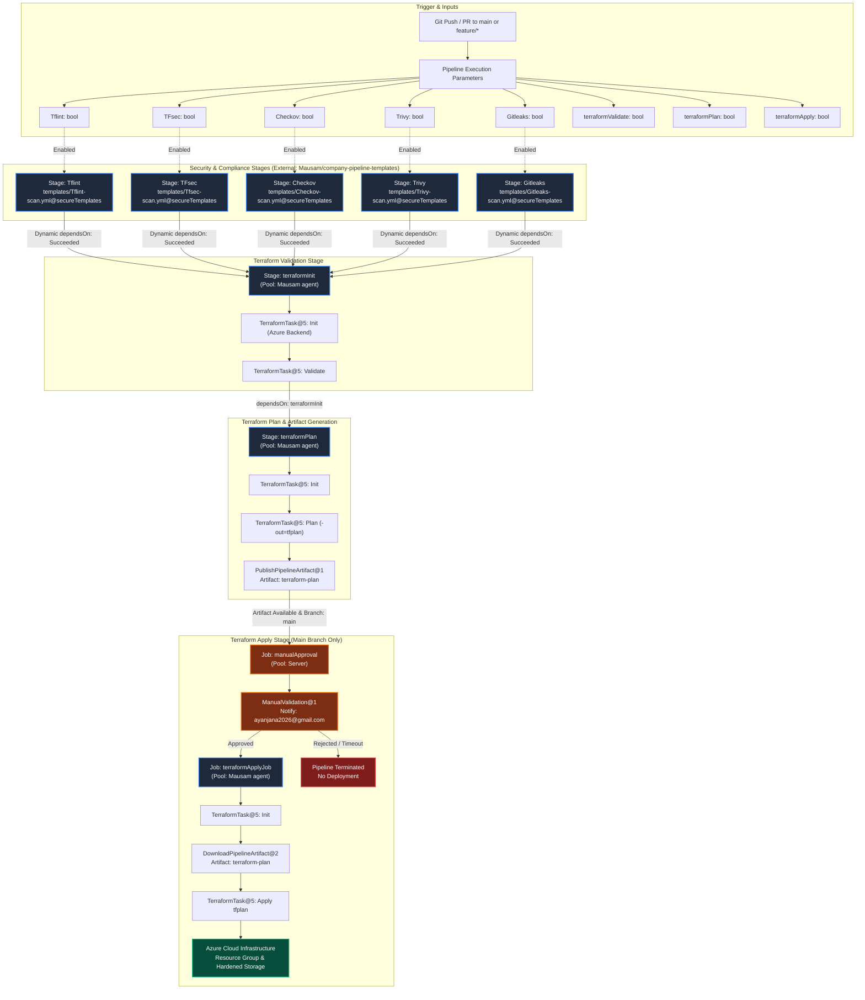

# Pipeline Architecture: Azure DevOps Multi-Stage DevSecOps Pipeline

## 1. High-Level Flowchart

The following diagram illustrates the complete execution topology, conditional branches, external template integrations, and artifact handoffs implemented in [azure-pipelines.yml](file:///d:/DevOps%20Coding/DevSecOps-Compliance-Pipeline/pipelines/azure-pipelines.yml):



---

## 2. Pipeline Parameters & Control Schema

The pipeline exposes 8 Boolean parameters configurable at queue time:

| Parameter Name | Display Name | Default | Purpose |
|---|---|---|---|
| `Tflint` | Run TFLint Scan | `true` | Executes TFLint static ruleset checks |
| `TFsec` | Run TFSec Scan | `true` | Executes TFSec static analysis |
| `Checkov` | Run Checkov Scan | `true` | Executes Checkov policy compliance verification |
| `Trivy` | Run Trivy Scan | `true` | Executes Trivy configuration vulnerability scanning |
| `Gitleaks` | Run Gitleaks Scan | `true` | Scans workspace for exposed secrets and keys |
| `terraformValidate` | Run Terraform Validate | `true` | Initializes backend and validates Terraform syntax |
| `terraformPlan` | Run Terraform Plan | `true` | Generates and publishes the binary execution plan |
| `terraformApply` | Run Terraform Apply | `true` | Enforces approval and applies changes to Azure |

---

## 3. Dependency & Condition Architecture

### 3.1. The "Skipped Dependency" Problem
In Azure DevOps, if Stage B statically declares `dependsOn: [StageA]`, and StageA is skipped (because its parameter was set to `false`), Azure DevOps considers StageA **not succeeded**. Consequently, Stage B's default condition `succeeded()` evaluates to **false**, unintentionally skipping Stage B.

Attempting to resolve this with `condition: succeededOrFailed()` or `in(dependencies...result, 'Succeeded', 'Skipped')` creates severe security risks: downstream stages would run even when a security scan actually **fails**!

### 3.2. The Solution: Compile-Time Expression Logic
This pipeline solves the dependency dilemma using Azure DevOps compile-time template expressions (`${{ if ... }}`):

```yaml
  - ${{ if eq(parameters.terraformValidate, true) }}:
    - stage: terraformInit
      displayName: 'Terraform Init & Validate'
      ${{ if or(eq(parameters.Tflint, true), eq(parameters.TFsec, true), eq(parameters.Checkov, true), eq(parameters.Trivy, true), eq(parameters.Gitleaks, true)) }}:
        dependsOn:
          ${{ if eq(parameters.Tflint, true) }}:
            - Tflint
          ${{ if eq(parameters.TFsec, true) }}:
            - TFsec
          ${{ if eq(parameters.Checkov, true) }}:
            - Checkov
          ${{ if eq(parameters.Trivy, true) }}:
            - Trivy
          ${{ if eq(parameters.Gitleaks, true) }}:
            - Gitleaks
      ${{ else }}:
        dependsOn: []
      condition: succeeded()
```

#### How it works:
1. **Dynamic Stage Registration:** If a parameter is `false`, that security stage is never compiled into the pipeline graph.
2. **Selective `dependsOn` Compilation:** The `dependsOn` array for `terraformInit` includes *only* those security stages that were actually enabled.
3. **Empty Array Fallback:** If all security scans are toggled off, `dependsOn: []` is rendered, allowing `terraformInit` to execute immediately.
4. **Strict Safety:** Because `condition: succeeded()` is maintained, if any active security scan fails, downstream execution is strictly blocked.

---

## 4. External Template Repository Integration

Security scan steps are maintained in a dedicated Git repository:
- **Repository Name:** `Mausam/company-pipeline-templates`
- **Alias:** `secureTemplates`
- **Branch Reference:** `refs/heads/main`

```yaml
resources:
  repositories:
    - repository: secureTemplates
      type: git
      name: Mausam/company-pipeline-templates
      ref: refs/heads/main
```

Each security stage delegates execution to its external template:
- `templates/Tflint-scan.yml@secureTemplates`
- `templates/Tfsec-scan.yml@secureTemplates`
- `templates/Checkov-scan.yml@secureTemplates`
- `templates/Trivy-scan.yml@secureTemplates`
- `templates/Gitleaks-scan.yml@secureTemplates`

This eliminates code duplication and ensures organizational security policy changes propagate instantly to all consumer pipelines.

---

## 5. Artifact Flow: Plan to Apply

```
[Agent Job: TerraformPlanJob]
   │
   ├─► terraform plan -out=$(workingDirectory)/tfplan
   │
   └─► PublishPipelineArtifact@1
          TargetPath: $(workingDirectory)/tfplan
          ArtifactName: 'terraform-plan'
                 │
                 ▼
          [Pipeline Storage]
                 │
                 ▼
[Server Job: ManualValidation@1] ─── (Inspection & Sign-Off)
                 │
                 ▼
[Agent Job: TerraformApplyJob]
   │
   ├─► DownloadPipelineArtifact@2
   │      ArtifactName: 'terraform-plan'
   │      TargetPath: $(Pipeline.Workspace)/terraform-plan
   │
   ├─► terraform init (re-initialize backend provider)
   │
   └─► terraform apply $(Pipeline.Workspace)/terraform-plan/tfplan
```

### Deterministic Plan Execution:
- **No In-Place Planning during Apply:** The pipeline does not run `terraform apply -auto-approve` against the codebase. It exclusively executes the compiled plan file generated during the plan stage.
- **Path Consistency:**
  - Artifact published from: `$(workingDirectory)/tfplan`
  - Artifact downloaded to: `$(Pipeline.Workspace)/terraform-plan`
  - Applied from: `$(Pipeline.Workspace)/terraform-plan/tfplan`

---

## 6. Manual Approval Design

Production infrastructure modification is protected by a dedicated server job:

```yaml
- job: manualApproval
  displayName: 'Manual Approval Gate'
  pool: server
  timeoutInMinutes: 1440
  steps:
    - task: ManualValidation@1
      displayName: 'Validate Plan & Approve Production Deployment'
      inputs:
        notifyUsers: 'ayanjana2026@gmail.com'
        instructions: 'Please inspect the terraform-plan artifact and security scan findings before granting production apply authorization.'
        onTimeout: 'reject'
```

### Key Technical Aspects:
1. **Server Pool (`pool: server`):** The job is agentless and does not occupy a self-hosted agent or build concurrency slot while waiting for human response.
2. **Notification Recipient:** Dispatches automated email notifications directly to `ayanjana2026@gmail.com`.
3. **Timeout Protection:** Configured with `timeoutInMinutes: 1440` (24 hours) and `onTimeout: 'reject'`. If no response is received within 24 hours, the job auto-rejects.
4. **Conditional Enforcement:**
   ```yaml
   condition: and(succeeded(), eq(variables['Build.SourceBranch'], 'refs/heads/main'))
   ```
   Apply and approval run **only** on the `main` branch. Feature branch runs terminate after the plan artifact is published.

### Difference Between ManualValidation@1 vs. Azure DevOps Environment Approvals:
- **`ManualValidation@1` (Current Implementation):** Declared directly within YAML using an agentless server job. Simple to configure, embedded in source control, and does not require pre-configuring Azure DevOps Environments or service checks in the UI.
- **Environment Approvals & Checks:** Configured through Azure DevOps UI under *Pipelines → Environments*. Uses `deployment` jobs (`deployment: deploy`) rather than standard jobs. While offering audit logging and automated checks, it requires separate portal administration.
